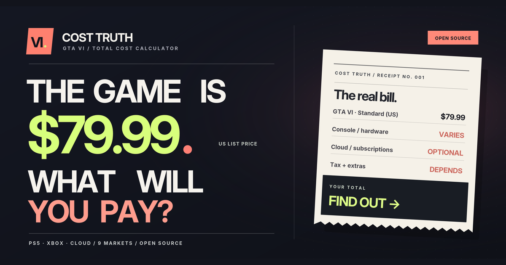

# GTA VI Cost Truth

**GTA VI cost calculator for PS5, Xbox, and supported cloud routes. Official regional prices, honest unknowns, and a receipt you can verify.**

**[Try the live calculator](https://fraware.github.io/gta-vi-cost-truth/)** · [Press and launch reference](PRESS.md) · [Use the calculation API](docs/API.md) · [Download the price data](data/prices.json) · [Review the sources](SOURCE_NOTES.md)



GTA VI's US Standard Edition is listed at $79.99. That is not necessarily the cost of getting started. This free, privacy-first calculator compares the game, console hardware, eligible cloud-playtime packs, optional expenditure, and estimated local taxes for your actual situation.

The output is a **source-linked receipt**, with each value classified as a dated first-party listing, visitor-provided quote, or unresolved amount. It never silently substitutes zero for a missing price.

## Try it

[**Open the interactive calculator**](https://fraware.github.io/gta-vi-cost-truth/). No account, backend, tracking, or API key is needed. Your inputs stay in the browser; shared URLs contain the scenario values you choose to share.

The first-party price snapshot covers nine markets: United States, France, United Kingdom, Canada, Australia, Germany, Spain, Italy, and Japan. Five markets have documented prepaid Xbox cloud-playtime packs. Hardware quotations are included only for verified market/model combinations. Unsupported price or eligibility claims stay unresolved.

## Reuse it

The core is a zero-dependency ES module. Node.js 20+ is supported for command-line and test workflows.

```bash
git clone https://github.com/fraware/gta-vi-cost-truth.git
cd gta-vi-cost-truth
npm run verify
```

### Import the engine

```js
import { calculate, defaultScenario, printMoney } from './src/index.mjs';

const result = calculate({
  ...defaultScenario(),
  market: 'FR',
  platform: 'xbox-one',
  route: 'cloud',
  plannedHours: 40,
});

console.log(printMoney(result.checkout, result.market)); // 90,98 €
console.log(result.cloudPlan?.selection);                // Cheapest whole-pack mix
console.log(result.lines);                               // Itemized first-party sources
```

The amount above is a dated **game-plus-playtime projection**, not a promise of subscription or device eligibility. Integer amounts use the currency's smallest unit, including zero-decimal JPY; there is no implicit exchange-rate conversion.

### Run the command-line calculator

```bash
node scripts/cost.mjs --market FR --route cloud --device xbox-one --hours 40
node scripts/cost.mjs --market US --route buy --device xbox-series-s --use-official-hardware --tax-rate 8.25
```

The command prints a structured JSON receipt for independent scripts and reports. [API reference](docs/API.md) documents the complete input and output contracts, evidence statuses, invalid cases, and exported functions.

### Use the machine-readable price data

[`data/prices.json`](data/prices.json) is a versioned JSON export of [`src/catalog.mjs`](src/catalog.mjs), with source links, dates, market currencies, available game prices, cloud packs, and hardware quotations.

```bash
npm run build:data    # Regenerate prices.json from the source catalog
npm run check:data    # Check that prices.json matches the catalog
npm run build:seo     # Update the crawlable nine-market HTML price table
npm run check:seo     # Check that the static table matches the catalog
```

[Data format and correction policy](docs/DATA.md). Pin a Git commit if building another tool from this snapshot. This is a dated, curated dataset, **not** a live-price API.

## Run the website locally

```bash
python3 -m http.server 8080
# Open http://localhost:8080/
```

The website uses static HTML, CSS, and native ES modules. `npm run build:demo` creates a self-contained offline HTML file. Test both the engine and the publication artifacts with `npm run verify`; CI also runs automated desktop/mobile Chromium flows.

## Trust boundaries

- **Unknowns stay unknown.** Missing console quotes, local tax rates, and unsupported cloud offers prevent a complete total. A known subtotal is still displayed and explained.
- **Platform claims stay separate.** PlayStation 5 and Xbox Series X|S are the confirmed native launch platforms. Xbox One has a documented Xbox cloud route; other cloud devices need title/device eligibility confirmation. A native PC launch is not included.
- **Tax and resale are conditional.** US and Canadian rates are visitor-entered estimates; merchant-specific rules may differ. Potential future resale proceeds do not reduce the initial amount due.
- **Prices have an observation date.** Source-backed means traceable to a first-party listing at the recorded time, not currently guaranteed at checkout.
- **No third-party game assets.** The interface uses original graphics and is unaffiliated with Rockstar Games, Take-Two Interactive, Sony, or Microsoft.

See [the detailed evidence ledger](SOURCE_NOTES.md) and [the release checklist](LAUNCH.md).

## Extend or contribute

Found an incorrect amount or a missing first-party listing? [Open a price correction](https://github.com/fraware/gta-vi-cost-truth/issues/new/choose). Reusing the engine in research or other tools? The module entry point and JSON format are documented and testable.

Start with [CONTRIBUTING.md](CONTRIBUTING.md). Corrections need an official retailer URL, edition or model, country, currency, observation date, tax interpretation, and regression test. Small accessibility and interface improvements are welcome.

## Prior art

Several GTA VI cost calculators and price indexes already exist, including GTA6Cost, GTA Corner, Kalkio, and LeonidaLab's pricing index. We do not claim to be the first. This project emphasizes explicit uncertainty, source-linked calculations, reproducible cloud-pack optimization, local-first sharing, and a reusable source catalog.

## License

[MIT](LICENSE) for original code and project material. Vendor trademarks and first-party storefront content remain the property of their respective owners. Copyright © 2026 Matéo Petel.
