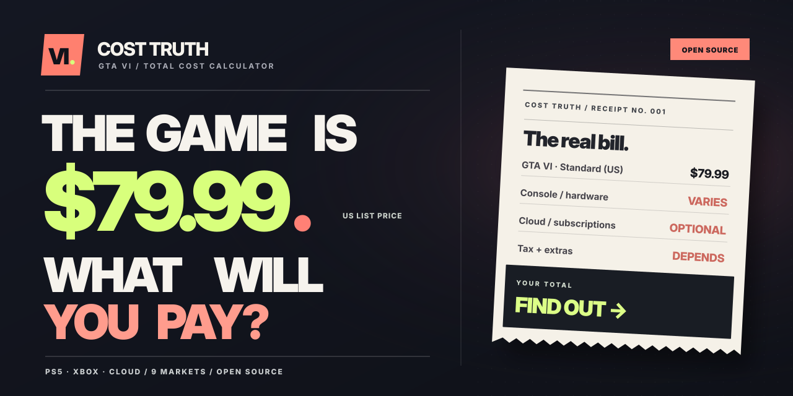

# GTA VI Cost Truth

**The game costs $79.99 in the US. What will it actually cost you to play?**

Independent, open-source cost receipts for Grand Theft Auto VI, released November 19, 2026, on PlayStation 5 and Xbox Series X|S. This project is unaffiliated with Rockstar Games, Take-Two Interactive, Sony, or Microsoft.

[Read the evidence log](SOURCE_NOTES.md) · [Reproduce the tests](tests/engine.test.mjs)

The site is prepared for GitHub Pages. Publishing needs repository Pages to be enabled in **Settings → Pages → Build and deployment → GitHub Actions**. Until then, the public URL is not live.



## What it does

Compare three purchasing situations: use a console you already own; purchase a new console; or stream using eligible Xbox devices, including Xbox One, through Xbox Cloud Gaming. Select the United States, France, or the United Kingdom, and Standard or Ultimate edition. Enter personal hardware quotes, sales tax, cloud playtime offers, and optional expenditure. Export an SVG receipt or share a URL containing the scenario, without accounts, cookies, analytics, or a backend.

**Unknown is never zero.** Every receipt item has a distinct status: `verified` means a dated first-party storefront observation, `entered` means a visitor-supplied estimate, and `unknown` means an amount that has not been established. An unresolved hardware quote, tax rate, or cloud tariff prevents the result from claiming a complete scenario total.

The optional projected resale value is disclosed separately and is not subtracted from the immediate purchasing expenditure.

## Run

The site is static and dependency-free.

```sh
python3 -m http.server 8080
# Open http://localhost:8080
```

Node.js 20+ is used for the test suite and for creating a portable, offline demo.

```sh
npm test
npm run build:demo
```

The calculation engine is a pair of ES modules in [src/catalog.mjs](src/catalog.mjs) and [src/engine.mjs](src/engine.mjs). All arithmetic operates on integer currency minor units, without FX conversion. Import `calculate` and `defaultScenario` from `./src/engine.mjs` for independent use.

## Method

The initial price snapshot was checked November 18, 2026 against official platform stores. US Standard $79.99, Ultimate $99.99. France €79.99 / €99.99. UK £69.99 / £89.99. France and UK storefront game prices are treated as VAT-inclusive; US sales tax is entered as an illustrative rate and is never assumed to be zero. Console prices, discounts, accessory expenses, resale proceeds, and cloud-playtime costs vary with market and consumer circumstances.

Xbox announced launch-day cloud streaming for GTA VI on Xbox One and Xbox Series X|S on November 10, 2026. Eligibility and purchasable cloud access vary. The cloud pack calculation is a user-supplied projection, not a representation of a universal subscription or an unrestricted tariff. GTA VI must be purchased separately.

Details, exact source URLs, and limitations appear in [SOURCE_NOTES.md](SOURCE_NOTES.md).

## Existing projects

This is not the first GTA VI cost calculator. Existing work includes [GTA6Cost](https://gta6cost.com/calculator/), [GTA Corner](https://www.gtacorner.com/cost-to-play), [Kalkio](https://kalkio.vercel.app/tools/gta-6-total-cost/), and the open-source [LeonidaLab pricing index](https://github.com/LeonidaLab/gta6-price-index). This project concentrates on source-linked line items, structured uncertainty, portable receipts, and a small independently testable engine. Those distinctions do not establish exclusive originality.

## Contributing

Price updates need a first-party source, currency, edition, market, collection date, tax interpretation, and a regression test. For bugs, inaccurate prices, accessibility issues, missing official restrictions, or additional prior art, open an issue with a reproduction or source link. No proprietary game assets are used in the project design.

## License

MIT for original code and graphics. Game names and other trademarks belong to their respective owners.
